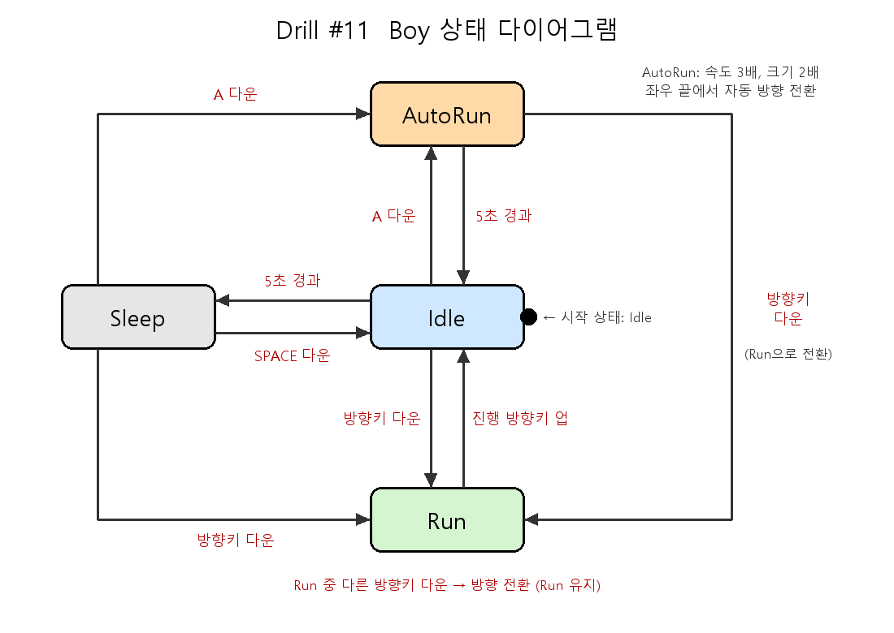

# PRD - Drill #11. 소년 자동 무적 런(AutoRun) 상태 추가

## 1. 개요
pico2d 기반 소년(Boy) 게임에 **AutoRun(자동 무적 런)** 상태를 추가한다.
소년의 동작은 `transitions` 라이브러리의 `Machine`으로 상태(IDLE / SLEEP / RUN / AUTORUN)와 전환을 정의해 구현한다.

## 2. 요구사항
| # | 요구사항 |
|---|----------|
| R1 | Idle 상태에서 `a` 키를 누르면 AutoRun 상태가 된다. |
| R2 | AutoRun 상태에서 소년은 Run보다 속도가 빠르고(5 → 15), 크기가 2배로 확대된다. |
| R3 | AutoRun 중 화면 좌/우 끝(0, 800)에 닿으면 자동으로 방향을 전환한다. |
| R4 | AutoRun 상태에서 5초 이상 경과하면 Idle 상태로 돌아간다. |
| R5 | AutoRun 상태에서 방향키(좌/우)를 누르면 AutoRun이 취소되고, 누른 방향으로 움직이는 Run 상태가 된다. |
| R6 | 상태 머신(`Machine`)에 `AUTORUN` 상태와 전환을 추가해서 구현한다. |
| R7 | 상태 다이어그램을 그려 저장소에 이미지 파일로 포함한다. (`state_diagram.png`) |

## 3. 상태 및 이벤트
- 상태: `Idle`, `Sleep`, `Run`, `AutoRun`
- 이벤트: 방향키 다운/업, `SPACE` 다운, `A` 다운, `TIME_OUT`(5초 경과)

| 현재 상태 | 이벤트 | 다음 상태 |
|-----------|--------|-----------|
| Idle | 5초 경과 | Sleep |
| Idle | 방향키 다운 | Run |
| Idle | A 다운 | AutoRun |
| Sleep | SPACE 다운 | Idle |
| Sleep | 방향키 다운 | Run |
| Sleep | A 다운 | AutoRun |
| Run | 진행 방향키 업 | Idle |
| Run | 방향키 다운 | Run (방향 전환) |
| AutoRun | 5초 경과 | Idle |
| AutoRun | 방향키 다운 | Run |

다이어그램: 

## 4. 구현 구조
- `boy.py`: `Boy` 클래스. `states`와 `add_transition`으로 상태 전환을 정의하고, `handle_event / update / draw`에서 상태별 동작을 처리
- `main.py`: 게임 루프, 이벤트 전달
- `grass.py`: 배경 잔디

## 5. 채점 기준 대응
- 'a' 누르면 AutoRun 상태 이동 (R1)
- 5초 이상 경과하면 Idle 상태 복귀 (R4)
- AutoRun에서 속도가 빨라지고 크기가 커짐 (R2)
- AutoRun에서 좌우 끝에서 자동 방향 전환 (R3)
- 상태 다이어그램 (R7)

## 6. 제출 방법
Public GitHub 저장소(`https://github.com/sinalpha/Drill11.git`)에 코드, 이미지 파일, `PRD.md`, 상태 다이어그램을 올리고 `.git` 주소를 e-Class에 제출한다.
